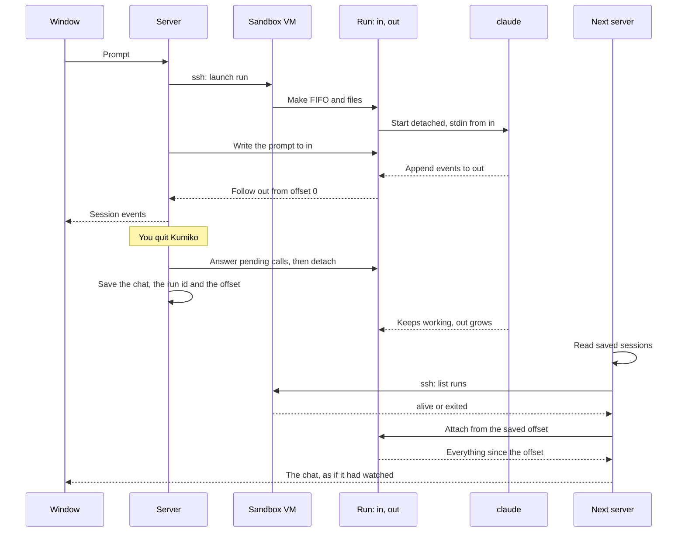

Each session's agent is a `claude` process in the sandbox. It isn't a child of Kumiko's server. It runs detached, in
a run of its own, and the server attaches to it over SSH. This is how an agent
[outlives the app](/features/outlive-the-app/): a quit, a restart or a dropped connection ends the attachment, not the
agent.

## The agent process

Kumiko starts Claude Code in its streaming mode. Claude reads one JSON object per line on stdin, writes one per line
on stdout, and stays alive between turns. The command line includes:

- `--input-format stream-json --output-format stream-json`, for the line protocol.
- `--permission-mode bypassPermissions`, because the sandbox is the boundary.
- `--permission-prompt-tool stdio`, so the two tools that ask you something, AskUserQuestion and ExitPlanMode, ask
  over the same streams. Kumiko shows them as cards.
- `--mcp-config` for the tools Kumiko hosts, such as artifacts, `deliver` and the `github_*` tools. Their calls go
  over stream-json's control protocol, so nothing in the VM opens a connection to your Mac.
- `--resume` with Claude's session id, when a session continues an earlier conversation.

`packages/agent/src/claude.ts` has the full command.

## A run

A run is a folder in the VM at `~/.kumiko/local/runs/<session id>-<n>/`. It is on the VM's own disk, not on a folder
mounted from your Mac, because FIFOs don't work across that mount.

| File | Holds |
| --- | --- |
| `in` | A FIFO, the agent's stdin. A holder process keeps a writer open on it, so the agent doesn't read end of file when an attachment goes away. |
| `out` | The agent's stdout, appended to. When the agent exits, a wrapper appends `{"type":"kumiko_exit","code":<n>}`. |
| `err` | The agent's stderr. |
| `exit` | The agent's exit code, once it has exited. |
| `pid`, `boot` | The agent's pid, and the kernel's boot id when it started. A pid means nothing after the VM reboots. |
| `owner` | The id of the Kumiko home whose server started the run. Servers on different homes leave each other's runs alone. |
| `attach.pid` | The attachment that writes to `in` now. A new attachment replaces it, because only one writer at a time keeps long lines whole. |

One shell script, sent with each command, does three things:

1. `launch` makes the run, starts the agent in a session of its own with `setsid`, waits for its pid, and attaches
   from the start.
2. `run` is the detached part: the holder, the agent, and the wrapper that records its exit.
3. `attach` copies its stdin into `in` and follows `out` from a byte offset with `tail -F`. End of file on its stdin
   ends it. It doesn't end the agent.

The script needs `bash`, `tail -F`, and `setsid` or `perl` in the sandbox. Runs are generic. Any agent that reads and
writes lines can run in one.

## Attaching and reattaching

The driver counts the bytes of `out` it has read, in complete lines. That count is the run's offset. Any driver can
attach to the run at an offset and carry on from exactly there.

An attachment that drops while the server runs is made again from the same offset, after a wait that grows with
each failed attempt.

When the server starts, it reads the saved sessions whose run was live. For each running sandbox it lists the runs
and their state:

- A run that is alive, or whose agent has exited since, is attached to again. The session opens as it was. A turn
  that ended meanwhile leaves the session idle and unread.
- A run that is gone, because the VM restarted, is marked dead. The session can still be resumed: Claude starts again
  with `--resume`.
- Runs that no saved session points at are stopped and deleted. This also happens when a sandbox starts.

Sessions of a sandbox that isn't running aren't attached to. They stay saved, to resume.

## Calls and questions across a restart

The agent can be waiting on Kumiko when the server goes: a call to one of Kumiko's tools, or a question or plan for
you. On detach, the server answers the calls it can for up to five seconds. The rest it saves with the session as pending,
and the next server answers them. A question waits for your answer with no time limit, across any number of restarts.

Kumiko only knows an answer arrived once Claude's tool result for it appears in `out`. So an answer may be sent twice.
Claude ignores the second.

Kumiko's own approval cards are different. The work behind a card waited on the server that is gone, so the next
server closes the card.

## What is saved

The server keeps a live session's whole event stream in memory, for tabs to replay. It saves only the chat to
`~/.kumiko/sessions/<id>.json`, with the deltas of a message still in progress. With the chat it saves the run's id,
the offset, and whether the run is live. See [State on disk](/architecture/state/).

A resumed session shows less than the live one did, because only the chat was saved.

## Ending a run

Closing a session closes the agent's stdin once its turn is done, and the agent exits. If it is still running five seconds
after a stop, Kumiko sends `SIGTERM`, then `SIGKILL` two seconds later. The run is deleted once the agent has exited.

Stopping, restarting or rebuilding a sandbox ends its agents, and its sessions fall asleep. They start Claude again,
continuing their conversations, once the sandbox runs. Deleting a sandbox ends its sessions for good.

## Costs

- `out` grows with every streamed token until the agent exits. Nothing rotates it.
- Only one server may use a Kumiko home at a time. `server.lock` enforces this.
- A request in flight when the server goes, such as a prompt or a stop, is lost with it.

[Decisions and trade-offs](/overview/decisions/) has the reasoning behind detached runs.
