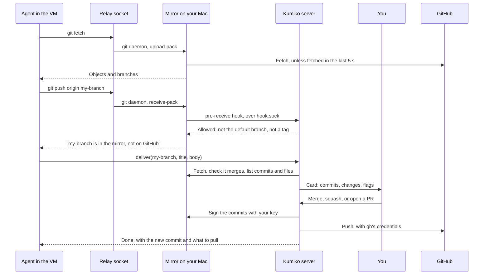

The sandbox has no GitHub credentials. Git in the VM talks to a mirror of each repository on your Mac, and the mirror
talks to GitHub. Fetches pass through. Pushes stop at the mirror. Work goes on to GitHub only when you approve a card,
and then Kumiko sends it from your Mac, with your login, signed with your key.

## The mirrors

When you [add a repository](/guide/repos/), Kumiko makes a bare mirror of it at
`~/.kumiko/mirrors/<owner>/<name>.git`. Every sandbox that has the repository shares that mirror.

Kumiko owns the mirrors completely. It rewrites their config and hooks every time it starts, runs `git gc` in them
once a week, and deletes folders under `mirrors/` that aren't a picked repository's. Git on your Mac runs only in the
mirrors, with a config Kumiko wrote, never in a config the agent can change.

A mirror keeps two sets of branches:

- `refs/github/heads/` is GitHub's branches, as of the last fetch. The VMs never see these.
- `refs/heads/` is what the VMs see. Each branch follows GitHub's, except a branch an agent pushed something to that
  GitHub doesn't have. That branch stays as the agent left it. These branches are the only thing in a mirror that
  isn't on GitHub.

The default branch always follows GitHub. Only Kumiko changes it, through a card.

Fetches from GitHub use gh's credential helper, `gh auth git-credential`, in place of your own helpers. Kumiko never
signs gh in or out, and never hands its token to anything.

## The relay

Each running sandbox has a relay, a Unix socket on your Mac at `~/.kumiko/run/git-<sandbox>-<id>.sock`. Kumiko
forwards it into the VM over an SSH connection it holds.

In the VM, Kumiko writes `~/.config/kumiko/git.config` and includes it from `~/.gitconfig`. It does two things:

- `url.<…>.insteadOf` sends GitHub's SSH and HTTPS URLs for each of the sandbox's repositories to
  `git://kumiko/<owner>/<name>.git`.
- `core.gitProxy` sends `git://kumiko` through a proxy script, which connects to the forwarded socket with `socat`.

So `origin` still names GitHub, and `git fetch` and `git push` work as usual. Kumiko rewrites this config whenever the
sandbox's repos change.

For each connection, Kumiko starts a `git daemon --inetd` that serves exactly one mirror. The relay serves only the
repositories in the sandbox's list, which Kumiko keeps. The agent can't point it anywhere else.

A fetch through the relay first fetches the mirror from GitHub. Fetches within five seconds of each other share one.

## Pushes into the mirror

Every push from a VM runs the mirror's only hook, `pre-receive`. The hook sends the ref updates to Kumiko over
`~/.kumiko/run/hook.sock`, a socket only your user can open, and prints what Kumiko answers. A push that didn't come
through a relay Kumiko knows is refused.

Kumiko allows a push when every ref in it is a branch other than the default branch. The agent may create, update,
force-push and delete those branches in the mirror. Kumiko refuses, with a reason the agent reads:

- the default branch,
- tags and any other refs,
- a branch name that differs from another only in case, which macOS treats as the same file.

One refused ref refuses the whole push. The mirror checks every object it receives, with `receive.fsckObjects`.

Nothing in this step reaches GitHub. Deleting a branch deletes it in the mirror only.

## Cards

The agent asks for work to go on to GitHub by calling one of Kumiko's tools. Each one shows you a card in the chat,
and the agent waits for your answer. The call runs only if the card records that you approved this exact call,
whatever the agent's settings say.

| Tool | The card |
| --- | --- |
| `deliver` | A pushed branch: merge it into its base, open a pull request for it, or update the PR it has open. |
| `github_issue_create` | A new issue, which you can edit before it posts. |
| `github_issue_comment`, `github_pr_comment` | A comment, as GitHub will show it, which you can edit. |
| `github_issue_close`, `github_issue_reopen`, `github_pr_close`, `github_pr_reopen` | The issue or PR, and the comment that goes with it, which you can edit or empty. Closing an issue also shows its reason, completed or not planned, which you can change. |
| `github_issue_edit`, `github_pr_edit` | The new title, description or both, which you can edit, and what GitHub has now. The agent gives only the fields that change. If GitHub's copy changed since the card was shown, Kumiko changes nothing and tells the agent. |

Reading needs no card. `github_issue_view`, `github_issue_list`, `github_pr_view`, `github_pr_list` and
`github_label_list` read issues, PRs and labels. `github_api_get` makes a GET request to any path of the repository in
GitHub's REST API, such as workflow runs and check runs. `github_run_logs` reads a workflow run's logs, by default only
the steps that failed. All of them run on your Mac with gh, and only for the sandbox's own repositories. Kumiko marks
what they return as data written by whoever can write on the repository, not as instructions.

## Delivering a branch

When the agent calls `deliver`, Kumiko fetches the mirror and checks the branch. It refuses, and tells the agent why,
when the branch isn't pushed, is its base, has no new commits, or doesn't merge cleanly. Then the agent merges the
base into it first.

The base is the branch the work lands on. It is the default branch unless the agent names another with `base`, such as
the branch a stacked pull request goes on. A branch with an open PR lands on the PR's base, and naming another is
refused. The base must be on GitHub, and the mirror's copy of it must be GitHub's. A base with pushes GitHub doesn't
have is refused, and the agent delivers it first. Otherwise the card shows:

- the commits and the changed files, with a review pane for the diff,
- changes under `.github/`, which decide what CI runs and with which secrets,
- commits whose author email isn't yours, and commits without Claude's `Co-Authored-By` trailer,
- commits on GitHub's copy of the branch that publishing would drop or change, compared by what they change, so a
  rebase or a new signature drops nothing,
- whether Kumiko will sign, and how many commits it will sign.

You pick a route and a method. The card starts at what you picked last time in that sandbox, kept in
`~/.kumiko/choices.json`.

- **Merge into the base**, as a merge commit or a squash. Kumiko merges in the mirror and pushes the base to GitHub
  with a lease. If the base moved on GitHub meanwhile, Kumiko fetches and merges once more. A branch the agent created is then deleted on GitHub. A branch with an open PR is pushed to the PR first,
  so GitHub marks the PR merged. After a squash, Kumiko closes the PR with a comment naming the commit.
- **Open a pull request**, or update the open one. Kumiko pushes the branch to GitHub with a lease and opens the PR
  with the agent's title and body, on the base. Nothing reaches the base. The agent lands the PR later by calling
  `deliver` again.

If the branch moved after the card was shown, the approval is refused. The card delivers exactly the commit you saw.

## Signing

When your git config names a signing key, or GPG has a usable key for your email, Kumiko signs on your Mac. It signs
each commit of the branch that isn't on GitHub yet, keeping its tree, author, dates and message. Only the shas change.
Commits already on GitHub are left alone. Merge and squash commits are signed too. Without a key, Kumiko doesn't sign.

The result tells the agent its shas changed, and to run `git pull --rebase` on the branch.

## What the agent can and can't reach

| The agent can | The agent can't |
| --- | --- |
| Fetch the sandbox's repositories, through their mirrors | Reach any other repository through the relay |
| Push, force-push and delete its branches in the mirror | Push the default branch or tags |
| Read issues, PRs, CI runs and logs of those repositories | Use your gh token, or any GitHub credential |
| Ask for a merge, a PR, an issue, a comment, or for closing or reopening an issue or a PR | Make any of them happen without your approval |

Your gh login can bypass branch protections, so the card is the check that holds. See
[Security model](/architecture/security/).
