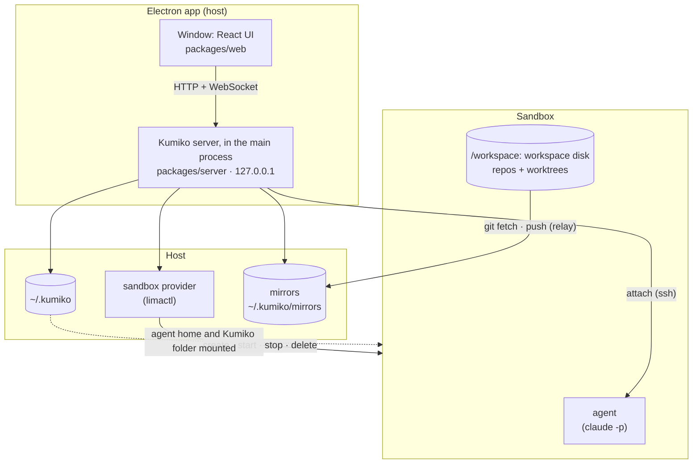
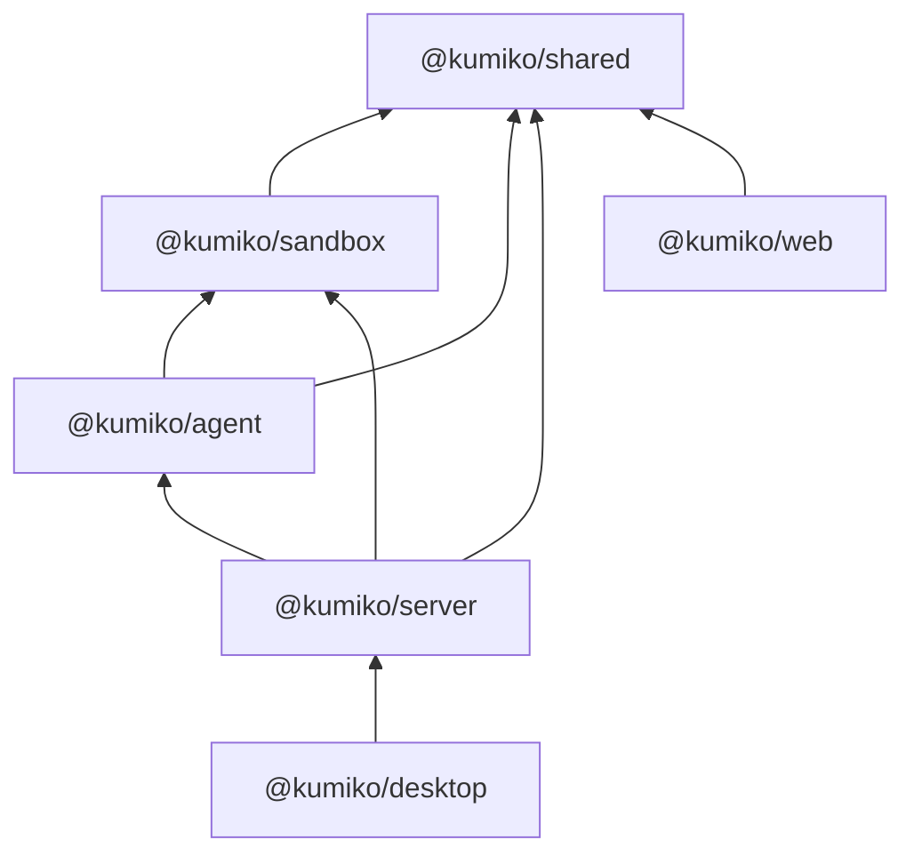

Kumiko is a local web app in an Electron shell. A Node server does the work: it manages sandboxes, keeps the repository mirrors,
drives the agents and serves the React UI. The window is a browser pointed at it.

## Processes

- **Electron main** (`apps/desktop`) starts the server in-process on a free local port and opens a window on it. It
  also owns the folder picker, the single-instance lock, quit confirmation and opening links in the browser.
- **The server** (`packages/server`) is Hono on Node's HTTP server, plus `ws`. Live state (sandbox list, operations,
  sessions) is in memory; durable state is JSON files under `~/.kumiko`.
- **The UI** (`packages/web`) is a React single-page app with hash routes.
- **The sandbox provider** creates and runs the sandboxes' VMs and workspace disks, and runs commands inside them.
- **The agent** runs in the sandbox, one process per session, alive between turns. It runs detached, in a run of its
  own (a FIFO for its input, a file for its output), so it outlives the server; the server attaches to it over SSH
  and attaches again after a restart. See [Decisions](/architecture/decisions/#agents-that-outlive-the-server).

## Packages

An npm workspaces monorepo in TypeScript. Packages build with `tsc -b`, the UI with Vite, and the desktop app bundles
the server with esbuild.

| Package | Does |
| --- | --- |
| `packages/shared` | Types and helpers the server and UI share: API shapes, events, name patterns, limits. No runtime dependencies. |
| `packages/sandbox` | The `SandboxProvider` interface, `LimaProvider`, and the sandbox records in `~/.kumiko/sandboxes/`. |
| `packages/agent` | The `AgentDriver` interface, `ClaudeDriver`, and a fake `claude` for tests. |
| `packages/server` | HTTP and WebSocket server: sandboxes, operations, sessions, mirrors and the git relay, login, usage. |
| `packages/web` | The React UI. Logic worth testing lives in plain modules (`chat.ts`, `pastes.ts`, …) with tests in `test/`. |
| `apps/desktop` | Electron main process and preload, the icon, and the dev loop (`dev.mjs`). |

## Channels

| Channel | Carries |
| --- | --- |
| `/api/…` (HTTP) | Reads and actions. Long actions answer `202` and report progress as events. |
| `/api/events` (WebSocket) | App-wide: sandboxes, operations and their logs, session status, mirrors. |
| `/api/sessions/:id/events` (WebSocket) | One session's events, replayed and then live. |
