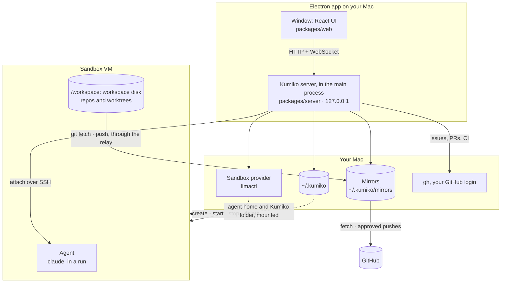

Kumiko is a local web app in an Electron shell. A Node server does the work. It manages the sandboxes, keeps the
repository mirrors, drives the agents and serves the React UI. The window is a browser page pointed at that server.

## Processes

- **Electron main** (`apps/desktop`) starts the server in its own process, on a free local port, and opens a window
  on it. It also owns the folder picker, the single-instance lock, the quit confirmation, links that open in your
  browser, and the panes that show previews and websites.
- **The server** (`packages/server`) is Hono on Node's HTTP server, with `ws` for WebSockets. It keeps live state in
  memory: the sandbox list, operations, sessions. It keeps durable state in JSON files under `~/.kumiko`. See
  [State on disk](/architecture/state/).
- **The UI** (`packages/web`) is a React single-page app with hash routes. It runs in the app's window, or in a plain
  browser during development.
- **The sandbox provider** creates and runs the sandboxes' VMs and workspace disks, and runs commands in them. Today
  this is Lima, through `limactl`.
- **The agent** runs in the sandbox, one process per session, and stays alive between turns. It runs detached from
  the server, so it keeps working when Kumiko quits or restarts. See [How an agent runs](/architecture/agent-runs/).
- **Git in the sandbox** reaches GitHub only through Kumiko's mirrors on your Mac. See
  [How code reaches GitHub](/architecture/github/).

The code is an npm workspaces monorepo. [Code layout](/development/layout/) lists the packages and what each depends
on.

## Channels

| Channel | Carries |
| --- | --- |
| `/api/…` over HTTP | Reads and actions. Long actions answer `202` and report progress as events. |
| `/api/events` over WebSocket | App-wide events: sandboxes, operations and their logs, session status, mirrors. |
| `/api/sessions/:id/events` over WebSocket | One session's events, replayed from an offset and then live. |
| SSH to the VM | Commands in the sandbox, and the attachment to each agent's run. |
| The agent's stdin and stdout | Prompts, the agent's output, its questions, and calls to the tools Kumiko hosts for it. |
| A Unix socket per running sandbox | Git in the VM, to that sandbox's mirrors. |

Every request to the API needs the server's token. [HTTP and WebSocket API](/reference/api/) lists the routes, and
[Security model](/architecture/security/#the-local-server) explains the checks.
