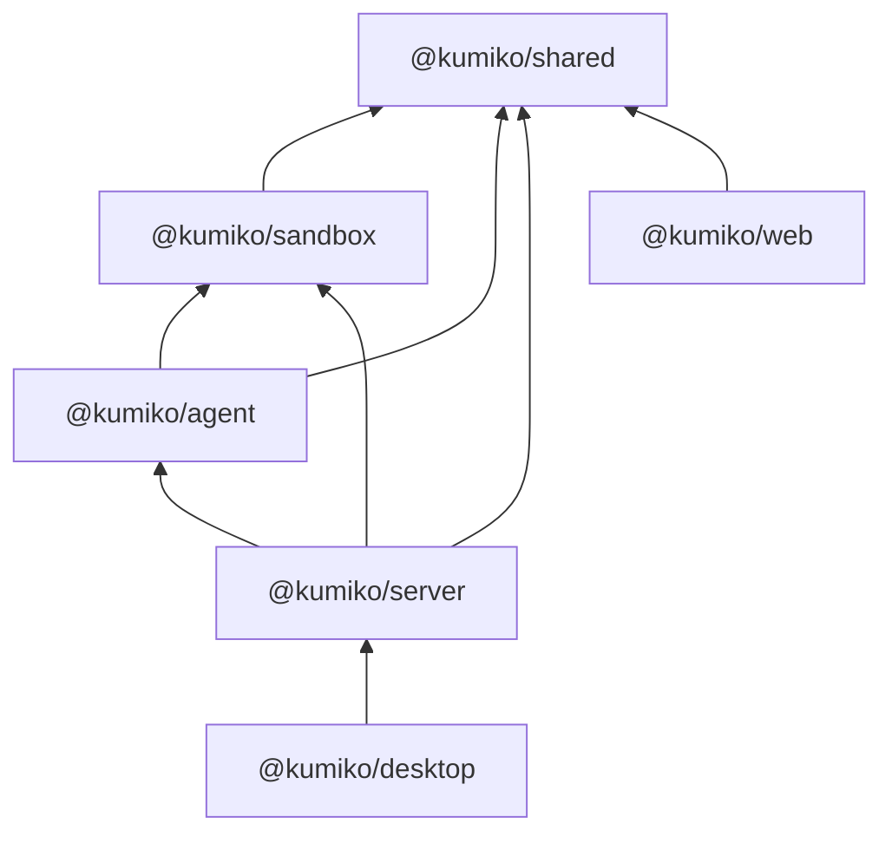

Kumiko is an npm workspaces monorepo in TypeScript.

```text
apps/desktop/      Electron main process and preload; bundles the server with esbuild
apps/docs/         This docs site
packages/shared/   Types and helpers the server and UI share
packages/sandbox/  SandboxProvider and the Lima provider
packages/agent/    AgentDriver and the Claude Code driver
packages/server/   HTTP and WebSocket server: sandboxes, sessions, mirrors, git relay
packages/web/      React and Vite UI
scripts/           release.mjs
```

## Dependencies



The UI depends only on `@kumiko/shared`. It talks to the server over HTTP and WebSocket, never by import.

## Packages

| Package | Does |
| --- | --- |
| `packages/shared` | Types and helpers the server and UI share: API shapes, events, cards, name patterns, limits. It has no runtime dependencies. |
| `packages/sandbox` | The `SandboxProvider` interface, `LimaProvider`, and the sandbox records in `~/.kumiko/sandboxes/`. The fake `limactl` and `ssh` are in `fixtures/`, and the checks against real Lima in `scripts/`. |
| `packages/agent` | The `AgentDriver` interface, `ClaudeDriver`, runs (`runs.ts`), the tools Kumiko hosts for the agent (`tools.ts`) and its questions (`asks.ts`). The fake `claude` is in `fixtures/`, and the checks against real Claude Code in `scripts/`. |
| `packages/server` | The HTTP and WebSocket server: sandboxes, operations, sessions, mirrors and the git relay, approvals and landing, login and usage. The fake `gh` is in `fixtures/`. |
| `packages/web` | The React UI. Logic worth testing lives in plain modules, such as `chat.ts` and `pastes.ts`, with tests in `test/`. |
| `apps/desktop` | The Electron main process and preload, the icon, the dev loop (`dev.mjs`) and the bundler script (`build.mjs`). |
| `apps/docs` | The docs site, and the script that takes its screenshots. |

## Builds

| Part | Built with | Output |
| --- | --- | --- |
| `shared`, `sandbox`, `agent`, `server` | `tsc -b` | `dist/` in each package |
| `web` | Vite | `packages/web/dist` |
| `desktop` | esbuild bundles the main process with the server, so the packaged app needs no `node_modules`. The preload is copied as it is | `apps/desktop/out` |
| The packaged app | electron-builder | `apps/desktop/release` |
| `docs` | Astro and Starlight | `apps/docs/dist` |

The packaged app carries the UI's `dist` as a resource and serves it from the bundled server.

[System overview](/architecture/overview/) shows how these parts run together.
