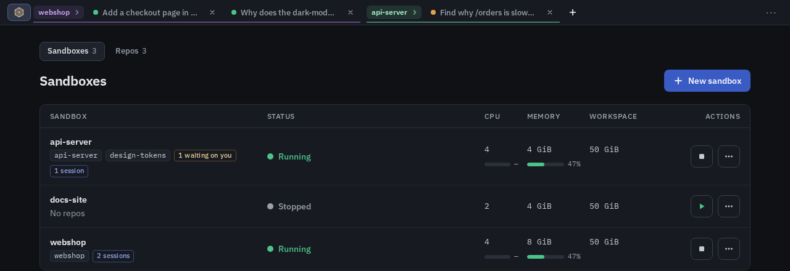

Each session is one conversation with the agent, in a tab of its own. You can run several at once in one sandbox and
across sandboxes. In one sandbox, each agent makes a git worktree for its task, so two tasks in the same repo don't
change the same files.

The **Sandboxes** tab shows every sandbox with its repos and its sessions, and marks the ones waiting on you. Tabs sit
together under a label with their sandbox's name and colour. So you can start a task, switch to another while the
first one works, and come back when Kumiko shows it is done or has a question.

## How to

- [Work in sessions](/guide/sessions/): tabs, closing, resuming, forking and rewinding.
- [Keyboard shortcuts](/reference/shortcuts/) for moving between tabs.
- Read why worktrees are a convention and not a rule: [Decisions and trade-offs](/overview/decisions/).
