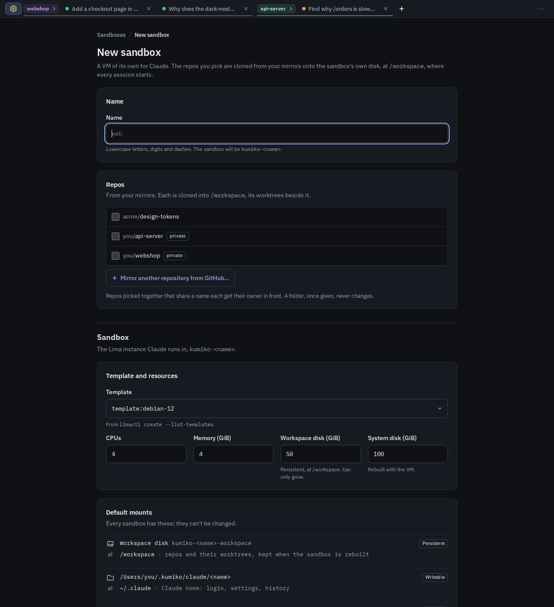

An agent gets most done when it doesn't stop to ask. It installs a package, runs the tests, tries a fix and runs them
again. A permission prompt at each step stops that work, and a prompt you approve without reading protects nothing.

In Kumiko, each sandbox is a virtual machine that belongs to the agent. Claude Code runs there with permissions
bypassed. It has root in the VM, and a disk of its own at `/workspace` with your repos cloned on it. It reaches only
what you gave the sandbox: its repos, the folders you mount, the variables you forward and the network. Your files,
your own Claude settings, other sandboxes and your Mac's localhost stay out of reach. You decide what the agent may
touch once, when you set up the sandbox, and not at every command.

The agent still asks you about the things that are yours to decide. Its questions and its plans come up as cards in
the chat, and nothing reaches GitHub until you approve it.

## How to

- [Create a sandbox](/guide/sandboxes/), and choose its mounts and forwarded variables.
- [Answer the agent's questions and plans](/guide/sessions/).
- Read why the sandbox is the boundary: [Principles](/overview/principles/) and
  [Security model](/architecture/security/).
