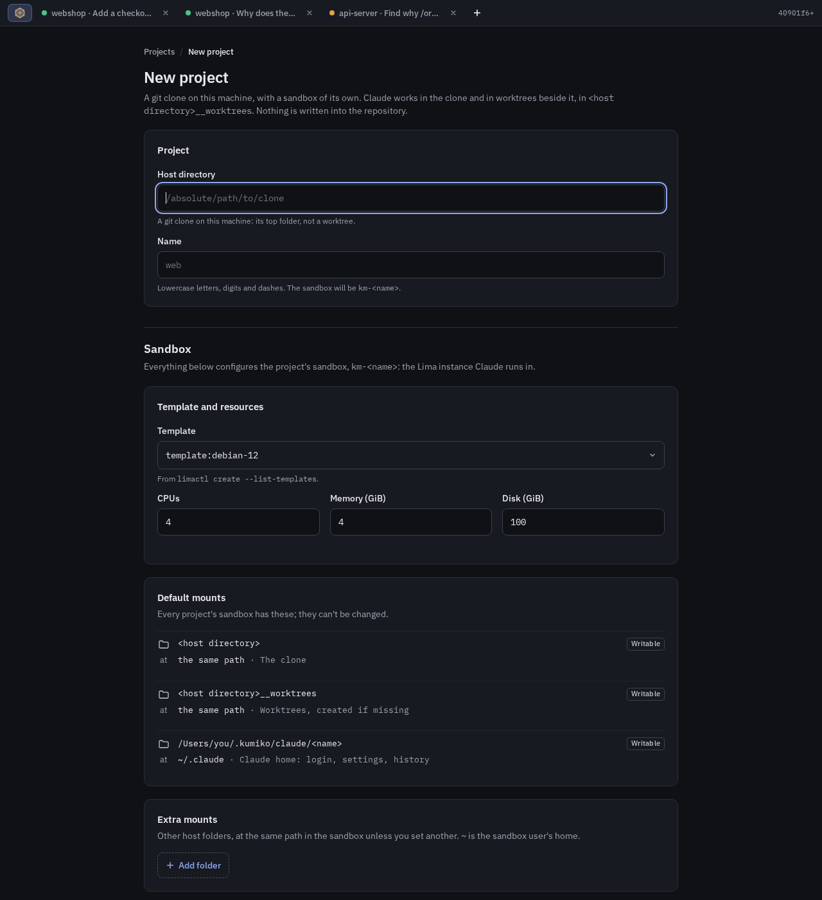

import { Steps, Aside } from "@astrojs/starlight/components";

By the end of this page an agent will be working on one of your projects, in a sandbox of its own. It takes about five
minutes, plus a few more while the first sandbox downloads its system image.

**You need:** a Mac, [Node 24+](https://nodejs.org), git, a git repository to work on, and a Claude account. This page
sets up today's sandbox provider, [Lima](https://lima-vm.io), and agent, [Claude Code](https://claude.com/claude-code);
Kumiko installs the agent for you.

<Steps>

1. **Install Lima, then build and launch Kumiko.**

   ```sh
   brew install lima
   git clone <kumiko repo> && cd kumiko
   npm install
   npm run desktop
   ```

2. **Create a project.** Choose **New project**, enter the path of your repository, and choose **Create project**. The
   defaults are fine for a first try.

   

   The project page shows the sandbox being built. Wait for it to say **Running**.

3. **Start a session.** Choose **New session**, say what you want done, and press <kbd>Enter</kbd>:

   ```text
   Read the README and tell me how to run the tests
   ```

4. **Log the agent in.** The first time, the reply is a card saying **Claude isn't logged in**, and a login dialog
   opens. Follow its link, sign in, paste the code into the dialog, and choose **Retry**. The agent gets to work.

</Steps>

<Aside type="tip">You log in once per project. The login is kept even if you rebuild the sandbox.</Aside>

## Next

- **Give it a real task.** Start a second session while the first one works, and watch both from the project page:
  see [Sessions](/guide/sessions/).
- **Set the sandbox up for your project:** the tools it needs and the tokens it may use. See
  [Projects and sandboxes](/guide/projects/#sandbox-settings).
