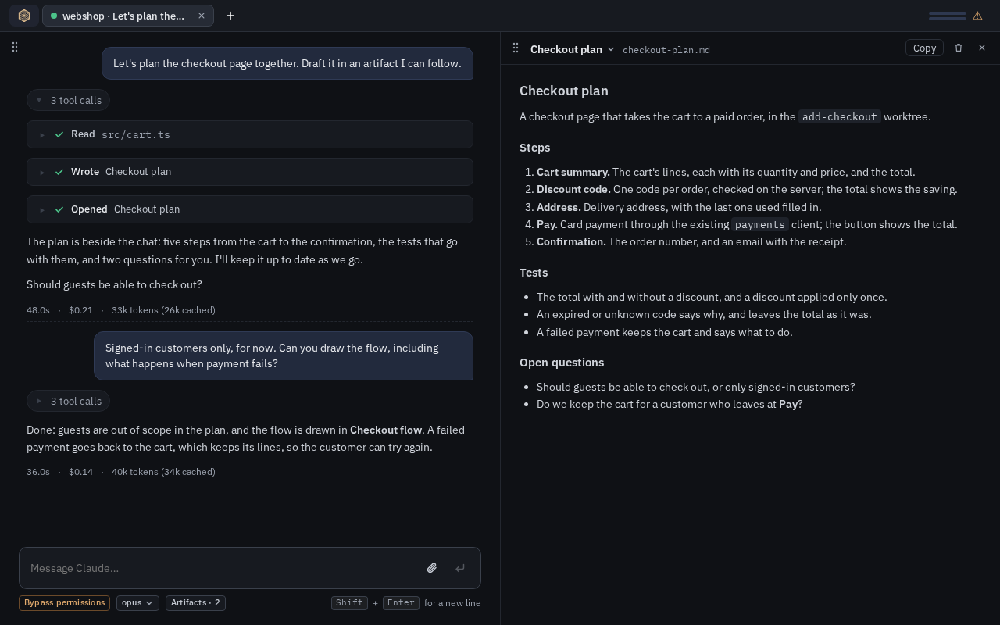

An artifact is a file the agent shows in a pane beside the chat and keeps changing while you look at it, such as a
plan it works out with you. Ask for one, as in "draft the plan in an artifact", or the agent opens one itself when it
fits.

## Kinds of artifact

| Kind | Shows |
| --- | --- |
| Markdown | A document, with Mermaid diagrams in fenced blocks |
| Mermaid | A diagram |
| SVG | A drawing |
| Image | A PNG, JPEG, GIF or WebP, up to 2 MB |
| HTML | A page |
| Preview | A page the agent serves in the sandbox, such as your dev server or Storybook |
| Website | A public site, once you allow it |

Images in a Markdown artifact load only from `https` addresses.

## Show a preview

For a preview to show, the dev server in the sandbox has to listen on `127.0.0.1` or `0.0.0.0`. With Vite, start it
with `--host 127.0.0.1`. **Load the page again** reloads it. The width menu shows the page at **Full width**,
**Desktop · 1280**, **Tablet · 768** or **Phone · 390**, to check how it lays out.

## Allow a website

When the agent opens a public website, the pane asks first: **Claude wants to open a website here**. **Allow** loads
it and lets the agent open other pages of that site in this session. **Deny** refuses. The site loads with none of
your logins, and can't reach your Mac or your network.

In a browser instead of the Kumiko app, websites open only in a tab of their own.

## Let the agent see what it made

The agent can take a picture of a pane as you see it, and reload a page first. It needs the session's tab open and on
screen in the Kumiko app.

## Arrange panes

- **Show or hide artifacts** with <kbd>Cmd</kbd>+<kbd>Shift</kbd>+<kbd>A</kbd>. The list shows every artifact of the
  session. <kbd>↑</kbd> and <kbd>↓</kbd> move, <kbd>Enter</kbd> shows or hides one, and <kbd>Esc</kbd> closes the
  list.
- **Show another artifact in a pane** from the menu on the pane's title.
- **Move a pane** by dragging its handle, ⠿. Drop it at the window's edge to have it span that whole side. Click the
  handle for a menu that moves it from the keyboard.
- **Close** hides an artifact. It stays in the session.
- **Delete** removes the artifact and its file. It asks for a second click, so a click meant for **Close** does
  nothing.

A dot on a pane's title marks an artifact that changed since you looked.

## Quote and reveal

- Select text in an artifact and press <kbd>Q</kbd> to quote it in your message, with a line naming the artifact.
- **Reveal in Finder** shows the artifact's file on your Mac. The same button appears beside a path in the chat, when
  the path is in a folder your Mac shares with the sandbox: the Kumiko folder or an extra mount.

## Edit an artifact yourself

Open the file in your own editor. The pane follows your changes. The agent isn't told, so ask it to read the file
again.

## Where artifacts are

Each session has its own folder, `~/.kumiko/sandbox/<sandbox>/artifacts/<session>/`, outside your repos. The sandbox
has that folder at the same path, so the path the agent names an artifact by is where it is on your Mac.

A rewind puts artifacts back as they were at that message. A fork gives the new session its own copies. Deleting a
saved session deletes its artifacts.

For what pages and previews can and can't reach, see the [security model](/architecture/security/#artifacts).
