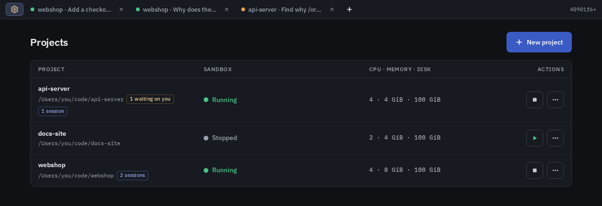

This page covers everything you can do with a project: create it, tune its sandbox, change it later, and remove it.

A project is a local git clone with one sandbox and one agent home. The **Projects** tab lists them, with each
sandbox's status and resources, how many sessions are open, and how many are waiting on you. Click a row to open the
project's page.



## Creating a project

**New project** takes a host folder (the clone) and a name, which defaults to the folder's name. Kumiko checks the clone
with git on the host:

- It must be the top folder of a non-bare repository's main working tree: not a subfolder, not a linked worktree.
- It must not already be a project, and the name must be free.

Kumiko creates `<clone>__worktrees` if it's missing and seeds the agent home.

## Sandbox settings

The rest of the form, under **Sandbox**, is the sandbox's settings. What they mean depends on the sandbox
provider; with Lima, the only one today, they describe a VM.

### Template and resources

Choose the sandbox's template, its CPUs, memory and disk. The form starts with sensible defaults.

### Mounts

Three mounts are always there, listed under **Default mounts**, and can't be changed:

| Host | In the sandbox | |
| --- | --- | --- |
| The clone | The same absolute path | writable |
| `<clone>__worktrees` | The same absolute path | writable |
| The project's agent home (shown as **Claude home**) | `~/.claude`, where Claude Code looks | writable |

**Extra mounts** are up to you. They default to the same path in the sandbox too. A sandbox path of `~/…` means the
sandbox user's home. Sandbox paths can't be `/` or `~` and can't overlap.

### Forwarded variables

List the **names** of host variables the sandbox should see, such as `GITHUB_TOKEN`. Kumiko stores only the names. Each
time it runs a command in the sandbox (provisioning, a session, a usage check) it reads the values from its own
environment and hands them to the command on stdin (over SSH, with Lima), so they never appear in a process list or
on disk.

### Provisioning script

A shell script run once, in the clone, when the sandbox is first set up. It runs with `set -e`, and each command is
echoed in the log before it runs, written as in the script, so `$GITHUB_TOKEN` shows as `$GITHUB_TOKEN`, never its
value.

Before your script, Kumiko installs the agent: Claude Code, with its native installer, linked to
`/usr/local/bin/claude`. If either fails, the sandbox shows **Provision failed**; fix the script and recreate it.

## Editing a project

**Edit** changes the sandbox's settings. The clone, name and template are fixed, and so are the default mounts. Two ways
to save:

- **Save and recreate sandbox** (the default) deletes the sandbox and creates it again from the changed settings,
  provisioning included. It works whether the sandbox is running or not, and the disk can shrink.
- **Save** keeps the sandbox. CPUs, memory, disk and mounts apply on its next start, and the disk can only grow. If
  the sandbox is running when they change, the button becomes **Save and restart sandbox**: it stops the sandbox,
  saves and starts it again, ending its live sessions. Forwarded variables and the script can change while it runs,
  but a new script only runs on a recreate.

## Restarting, recreating and deleting

- **Restart sandbox** stops a running sandbox and starts it again, ending its live sessions (it asks first if there
  are any). The disk is kept, so nothing is provisioned again.
- **Recreate sandbox** deletes the sandbox and creates it again from its stored settings. The agent home and the
  saved sessions stay, and so does the login.
- **Delete** removes the project, its sandbox, its agent home and its saved sessions, after asking. The clone and its
  worktrees are never touched.

## Getting a shell

To look around in a sandbox yourself, with Lima:

```sh
limactl shell km-<project>
```

The shell starts in the clone, with the agent (Claude Code) on `PATH` and pointed at the project's agent home.
