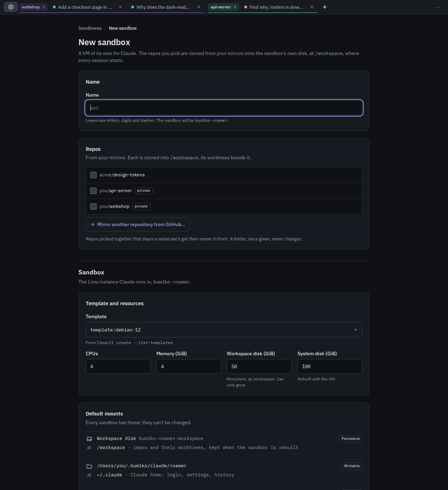

import { Steps, Aside } from "@astrojs/starlight/components";

This page takes you from nothing to an agent working on one of your repositories, in a sandbox of its own. It takes
about five minutes. The first sandbox takes a few minutes more, while it downloads its system image.

**You need** a Mac, [Homebrew](https://brew.sh), git, a GitHub repository to work on, and a Claude account. Kumiko
uses [Lima](https://lima-vm.io) for sandboxes and [Claude Code](https://claude.com/claude-code) as the agent. You
install Lima yourself. Kumiko installs Claude Code in each sandbox.

<Steps>

1. **Install Lima and the GitHub CLI**, and sign the CLI in. Kumiko needs Lima 2.3 or later.

   ```sh
   brew install lima gh
   gh auth login
   ```

2. **Install Kumiko.** Open the Releases page of the Kumiko repository on GitHub. From the release marked **Latest**,
   download `Kumiko-<version>-arm64.dmg` for Apple silicon or `Kumiko-<version>-x64.dmg` for an Intel Mac. Open it
   and drag **Kumiko** into **Applications**.

   The **unstable** pre-release on that page is built from every change on `main`. Take it to try what's coming. It
   may be broken.

3. **Open Kumiko.** Apple hasn't signed Kumiko yet. The first time you open it, macOS says it can't check the app for
   malicious software and offers only **Done** and **Move to Trash**. Choose **Done**. Open **System Settings**, then
   **Privacy & Security**, and scroll to **Security**. Choose **Open Anyway** beside the message about Kumiko, and
   confirm with your password. After that, Kumiko opens like any other app.

   You can instead clear the download's quarantine in Terminal, then open Kumiko as usual:

   ```sh
   xattr -dr com.apple.quarantine /Applications/Kumiko.app
   ```

   macOS asks again for each new version you download.

4. **Add your repository.** Open **Repos**, choose **Add repository**, and pick it. Kumiko makes a mirror of it on
   your Mac.

5. **Create a sandbox.** Open **Sandboxes** and choose **New sandbox**. Give it a name, tick your repository, and
   choose **Create sandbox**. The default settings are fine for a first try.

   

   The sandbox page shows the sandbox being built. Wait until it says **Running** and the repo says **Cloned**.

6. **Start a session.** Choose **New session**, say what you want done, and press <kbd>Enter</kbd>:

   ```text
   Read the README and tell me how to run the tests
   ```

7. **Log the agent in.** The first reply is a card saying **Claude isn't logged in**, and the **Log in to Claude**
   dialog opens. Follow its link, sign in, paste the code into the dialog, and choose **Log in**. Then choose
   **Retry** on the card. The agent gets to work.

</Steps>

<Aside type="tip">You log in once per sandbox. A rebuild of the sandbox keeps the login.</Aside>

<Aside>
To run Kumiko from source, see [Set up and run from source](/development/setup/).
</Aside>

## Next steps

- Start a second session while the first one works, and follow both from the **Sandboxes** tab. See
  [Work in sessions](/guide/sessions/).
- Give the sandbox the tools and tokens your work needs. See
  [Create and manage sandboxes](/guide/sandboxes/#sandbox-settings).
- See how the agent's work gets to GitHub in [Review, push and merge](/guide/shipping/).
