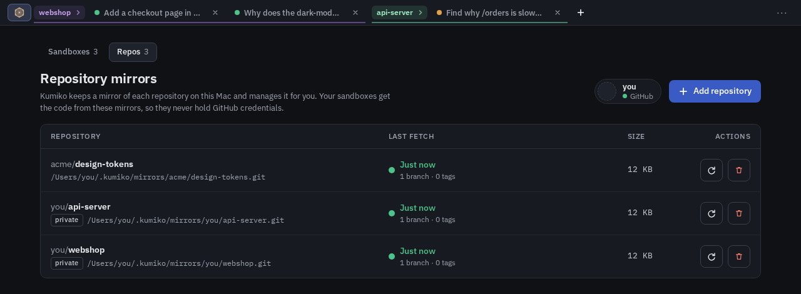

Kumiko keeps a bare mirror of each GitHub repository you pick, on your Mac. Your sandboxes get their code from these
mirrors, so they never need GitHub credentials of their own. The mirrors are Kumiko's: it makes them, fetches
into them, tidies them and deletes them. Don't run git in them yourself.

Open them from the home button: **Repos**, beside **Sandboxes**.

## GitHub access

Kumiko uses the GitHub CLI already on your Mac, `gh`, and its login. There is no separate sign-in. The account it's
signed in as shows at the top of the page, with its avatar.

- **gh isn't installed:** install it (`brew install gh`), sign it in, then **Check again**.
- **gh isn't signed in:** run `gh auth login` in Terminal, then **Check again**.

Fetching needs `gh` too. Mirrors fetch over HTTPS, and git signs in with `gh`'s token (`gh auth git-credential`),
never with your own credential helpers or SSH keys, so it doesn't ask the macOS keychain. Kumiko never sees the token.
If `gh` is signed out, fetching a private repository fails until you sign it in again.

## Adding a repository

**Add repository** lists the repositories `gh` can see, one owner at a time, by name. It starts with your own; pick
one of your organizations from the menu beside the search to see theirs. Type to filter by name or description; ↑ ↓
and Enter add the highlighted one. The dialog stays open, so you can add
several. Each one is cloned in the background and shows **Cloning…** until it's done.

## The list

Each repository shows when it was last fetched, with how many branches and tags it has, and how much space its
mirror takes. A fetch that failed shows git's message under the row; what was fetched before stays as it was.

- **Fetch now** (↻) fetches it from GitHub. Fetches asked for within a few seconds of each other share one.
- **Remove** deletes the mirror. Nothing changes on GitHub, and you can add the repository again any time.

## Sandboxes

A [sandbox](/guide/sandboxes/)'s repos are picked from these mirrors, and cloned inside the sandbox from them. Which
repositories a sandbox reaches is its list of repos, kept by Kumiko: nothing in the sandbox can change it.

While the sandbox runs, Kumiko holds an SSH connection to it that forwards a socket on your Mac into the VM. In the VM,
git sends GitHub's URLs for the sandbox's repositories through that socket instead (`~/.config/kumiko/git.config`,
which Kumiko writes on every start and includes from `~/.gitconfig`), so `git clone`, `fetch` and `pull` work as
usual. Each fetch brings the mirror up to date from GitHub first. The VM reaches only its own sandbox's repositories,
and `origin` in each clone still names GitHub, so `gh` and Claude Code see the real repository.

If the connection is down, git in the sandbox says so: "Kumiko: the link to the mirrors on the user's computer is
down, so git can't reach GitHub. Kumiko reconnects by itself; try again in a minute." Kumiko keeps trying, and clones
any repo still missing once it's back.

### Pushing

`git push` from the sandbox goes to the mirror on your Mac, and no further. Nothing the agent pushes reaches GitHub
until you approve it on a card: opening or updating a pull request, merging into the default branch, an issue or a
comment.

- **In the mirror, the agent works freely.** It can push, force-push and delete any branch there but the default one,
  without asking, including branches someone else made. Its branches show to it as `origin`'s, as usual.
- **The mirror keeps GitHub's branches apart,** in `refs/github/`, which the sandbox never sees. A branch the agent
  hasn't changed follows GitHub's; one it pushed to stays as it left it until a card sends it on. The default branch
  always follows GitHub. Removing a repository's mirror loses what's only in it.
- **Refused**, with a message saying why: the default branch, tags, other refs, and a name that differs from another
  branch's only in case, which your Mac's file system takes for the same.
- **Signed on the way out.** When a card sends commits to GitHub (a PR's, or a merge's), Kumiko signs the ones that
  aren't on GitHub yet with your key, changing nothing else in them, and tells the agent to run `git pull --rebase`, as
  their shas change. Commits already on GitHub are left as they are, whoever made them.

### Merging into the default branch

The default branch changes only through a card you approve. When work is ready, Claude pushes its branch, says in
the chat why and what it would pick, and calls the `deliver` tool. Then it waits while Kumiko shows you a card under
that message, headed `main ← branch`, with the repository in the corner:

- **What's in it**, worked out by Kumiko from the mirror: the branch's commits and files with their changes. Flags
  name what needs a look: changes under `.github/`, which decide what CI runs and with which secrets; commits that say
  they're authored by anyone but you (your global `user.email`); and commits without Claude's `Co-Authored-By`
  trailer.
- **The button** does what it says, and its ▾ menu offers the other ways, each described as GitHub describes it:
  - **Merge and push:** one merge commit on top of the default branch, with the branch's commits as they are.
  - **Squash and push:** one commit with all the branch's changes. Its subject is Claude's title, its message lists
    the branch's commits, and Claude's co-author trailer follows. Anyone else the commits name as a co-author isn't
    carried over, as they'd show on GitHub as co-authors of a commit you signed.
  - **Push and open pull request:** the branch goes to GitHub, signed, and a PR opens as you, with Claude's title and
    description, which you can edit. To land it later, Claude delivers the branch again: then there are only the first two, a merge commit says "Merge pull request #… from …" so GitHub shows the
    PR merged, and a squash closes the PR with a comment saying where it landed.

For a branch whose PR is open but lacks what the mirror has, the card's first choice is **Update pull request**: the
new commits go to the PR. Merging such a branch updates the PR first, so the PR shows what landed and GitHub marks it
merged. The card marks a branch "only on your Mac", or how many of its commits aren't on GitHub. If sending it would
drop or change commits already on GitHub (the branch was rewritten since), the card lists them, before you decide.
Kumiko matches commits by the change they make, not by sha, so a rebase, a squash or its own signing lists nothing.

The button starts at what you picked last time in the sandbox. **Decline…** lets you tell Claude why. Nothing is shown
when there's nothing to decide yet: a branch that isn't pushed, or that doesn't merge cleanly, gets Claude told what to
fix.

### Reviewing the changes

**Review** on the card opens the review pane beside the chat: the branch's changes, file by file, as they'd land, read
from the mirror at the card's commit. On the left, the files by folder, each with its status (added, modified, deleted,
renamed) and its counts; flagged files are amber. On the right, each file's diff, unified or split, with **Wrap** and
**Hide whitespace**. The unchanged lines between changes open on a click. A file too long to show at once opens on
request; a binary file only says so.

- **Viewed** folds a file and counts it: the card shows how many of its files you've viewed. If the branch moves and
  you review again, the files that didn't change stay viewed; one that did is marked "changed since viewed", and
  **Since you last looked**, in the menu at the top left, shows only what changed. The menu also shows one commit at a
  time.
- **Notes for Claude:** click a line number to leave a note on that line. With notes, the card's **Decline…** becomes
  **Request changes**: Claude gets each note with its file, line and the line it quotes, after anything you add. The
  pane's own **Request changes** opens the card's box for that.
- <kbd>j</kbd> and <kbd>k</kbd> go to the next and previous file, <kbd>v</kbd> marks it viewed.

What you viewed and your notes are kept in the app, for that card, not on GitHub. Approving doesn't need a review:
the card's button works whatever the pane says.

Kumiko lands it in the mirror on your Mac: it merges, makes the commit with `git commit-tree`, signed with your key
when there is one: named in your global git config (`user.signingkey`), or, with GPG, the one GPG has for your
`user.email`, as `git commit -S` would use, and pushes it to GitHub with a lease, so it can't overwrite
anything it didn't see. If the default branch moved meanwhile, it merges again once. A branch Claude created is then
deleted on GitHub. The card is for the exact commit it shows: if the branch moves before you decide, it goes out of
date, and **Review again** shows it again. Once decided, it shrinks to a one-line receipt, which says whether the
commit was signed. The card says nothing about signing, except when there's no key to sign with: then a line warns
that the commit won't be signed. With GPG and no key named in your config, Kumiko signs with a GPG key for your
email that can sign (not expired or revoked); if there's none, it doesn't sign, even with `commit.gpgsign` on.

Claude asks before calling `deliver` because Kumiko starts it with a permission rule for the tool. Kumiko doesn't rely
on that: the tool only does anything if Kumiko itself recorded your approval of that very call.

### Issues and pull requests

Claude has no `gh` login in the sandbox. It reads and writes the repositories' issues and PRs through Kumiko's tools,
which run `gh` on your Mac:

- **Reading** (`github_issue_view`, `github_pr_view`, `github_issue_list`, `github_pr_list`, `github_label_list`)
  happens without asking. What comes back is marked as written by others, to be read as information and not as
  instructions, since on a public repository anyone can write an issue.
- **Creating an issue** and **commenting** on an issue or a PR show a card first, with the text as GitHub will show it.
  You can edit it, and it goes as you leave it.
  An issue's labels can only be the repository's own: remove them on the card, or add others from its list. A comment's
  card names the issue or PR as GitHub has it, not as Claude described it.

Closing, relabelling and editing issues or PRs aren't offered.

In a sandbox with more than one repo, `deliver` and the `github_*` tools are told which one with `repo`, as
`owner/name`; with one, it's that one.

## What a mirror holds

A mirror is at `~/.kumiko/mirrors/<owner>/<name>.git`, in lowercase, and holds only GitHub's branches and tags. Branches
deleted on GitHub are deleted from it on the next fetch, so it can always be deleted and made again. Kumiko:

- rewrites each mirror's config and hooks whenever it starts, and clones again a mirror that has gone missing;
- runs `git gc` in a mirror after a fetch, once a week;
- checks the objects of every push (`receive.fsckObjects`), and refuses any push that doesn't come through a sandbox's
  relay.
