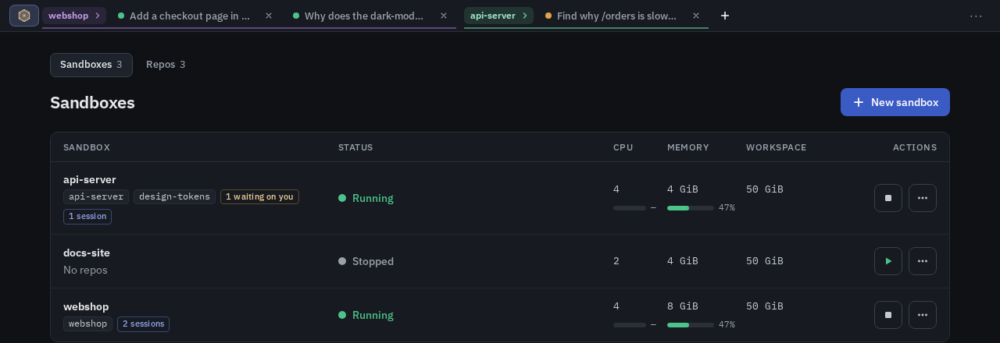

A sandbox is a VM of its own for the agent. It has an agent home, a workspace disk, and the repos you picked from your
[mirrors](/guide/repos/), cloned onto that disk. For how the pieces fit together, see
[Concepts](/overview/concepts/).

The **Sandboxes** tab lists every sandbox with its repos, status and resources, how many sessions are open, and how
many are waiting on you. Click a row to open the sandbox's page.



## Create a sandbox

1. On the **Sandboxes** tab, choose **New sandbox**.
2. Give it a name of lowercase letters, digits and dashes. The VM is called `kumiko-<name>`. The name can't change
   later.
3. Tick the repos it works on. **Mirror another repository from GitHub…** adds a mirror first and ticks it.
4. Check the settings under **Sandbox**. The defaults are fine to start with.
5. Choose **Create sandbox**.

The sandbox page shows the build as it happens: creating the VM, installing Claude Code, your provisioning script,
then cloning the repos. When it says **Running**, you can start sessions.

### Where the repos go

Kumiko clones each repo into `/workspace/<folder>`, with its worktrees beside it in
`/workspace/<folder>__worktrees`. The form shows each repo's folder.

- A repo's folder is its name, such as `/workspace/api`.
- Repos picked together that share a name each get their owner in front, such as `acme-api` and `szajbus-api`.
- A repo added later whose name is taken gets its owner in front. A folder, once given, never changes.

The clones are made in the sandbox, from the mirrors, once it runs. `origin` keeps GitHub's URL, so tools in the
sandbox see the real repository. A sandbox can have no repos at all.

## Sandbox settings

The settings under **Sandbox** depend on the sandbox provider. With Lima, the only provider today, they describe a
VM.

### Template and resources

Pick the template, the number of CPUs, the memory, the workspace disk's size and the system disk's size. The template
can't change later.

The workspace disk holds `/workspace`: the repos, their worktrees, and everything else the agent leaves there. It
outlives the VM. A rebuild keeps it, and deleting the sandbox deletes it. It needs Lima 2.3 or later, and grows only
while the sandbox is stopped. Nothing on your Mac opens it.

The system disk holds everything else, and a rebuild replaces it.

### Mounts

Every sandbox has three mounts that can't be changed:

| From | In the sandbox | |
| --- | --- | --- |
| The workspace disk | `/workspace` | persistent |
| The sandbox's agent home, shown as **Claude home** | `~/.claude`, where Claude Code looks | writable |
| The sandbox's **Kumiko folder**: the agent's setup scripts and the sessions' artifacts | the same path as on your Mac, and `~/.kumiko/shared` | writable |

The Kumiko folder is `~/.kumiko/sandbox/<name>/` in your home on your Mac. The sandbox mounts it at that same path, so
a path the agent gives you there is one you can open as it is. If an extra mount is in the way of that path, the
Kumiko folder is mounted only at `~/.kumiko/shared`.

**Extra mounts** share folders from your Mac. Choose **Add folder…**, pick the folder, and choose whether it's
writable. It appears at the same path in the sandbox unless you give another one. A path starting with `~/` means the
sandbox user's home. A sandbox path can't be `/` or `~`, can't overlap another mount, and can't be in `/workspace`.

Kumiko treats an extra mount as a folder, not a repo. If it's a git clone, git on your Mac runs whatever the agent
writes into its config. See the [security model](/architecture/security/).

### Forwarded variables

List the names of variables from your Mac's environment that the sandbox should see, such as `NPM_TOKEN`. Kumiko
stores only the names. Each time it runs a command in the sandbox, it reads the values from its own environment and
passes them on stdin. The values never appear in a process list or on disk.

Kumiko reads your login shell's environment when it starts, so variables your shell profile exports are there. The
form shows **Set on host** for a variable that has a value, and **Not set: will be skipped** for one that doesn't.

### This Mac's localhost

By default, the sandbox can't reach services listening on your Mac's `127.0.0.1`, such as databases, dev servers and
other apps' local APIs. Turn on **Let Claude reach services on this Mac's localhost** when the agent needs one of
them. The change applies the next time the sandbox starts.

The block needs Lima 2.3 or later and a `vz` VM, the default on macOS. Without them, the sandbox page says the sandbox
can reach your Mac's localhost.

### Provisioning script

A shell script that runs once, in `/workspace`, when the sandbox is first set up. It runs with `set -e`. The log shows
each command before it runs, as written in the script, so `$NPM_TOKEN` shows as `$NPM_TOKEN` and never as its value.
Keep secrets out of the script and use forwarded variables.

Before your script, Kumiko installs Claude Code with Anthropic's native installer and links it to
`/usr/local/bin/claude`. If that or your script fails, the sandbox says **Provisioning failed**. Fix the script and
rebuild the sandbox.

The agent gets a copy of your script as `user-provision.sh` in the Kumiko folder, so its own setup scripts don't
repeat what yours does.

### The agent's setup scripts

The agent installs what its work needs as it goes, and writes each step down as a setup script so a rebuilt sandbox
gets it again. The scripts run when the sandbox is created, after your provisioning script. If one fails, the sandbox
says **Running · agent setup failed**.

You don't need to do anything with them. To see them, open **Agent's setup scripts** on the sandbox page. To start
over, choose **Delete scripts** there. The sandbox keeps what they set up until you rebuild it. Then it starts from
your provisioning script alone.

## Use the sandbox page

The sandbox page shows the sandbox's sessions, repos, settings, mounts and variables, the agent's setup scripts, and
the log of the last operation.

Each repo shows its GitHub name, its folder and the state of its clone:

| State | Means |
| --- | --- |
| **Cloned** | The clone is there. |
| **Cloning…** | Kumiko is cloning it. |
| **Clone failed** | The clone failed. Git's message says why. A folder in the way that isn't a git clone is left alone. |
| **Not cloned yet** | The sandbox hasn't run yet, or git in it can't reach the mirrors yet. The reason shows when there is one. |
| **Checked when the sandbox starts** | The sandbox is stopped. Kumiko checks every repo each time the sandbox starts. |

**Start** and **Stop** start and stop the VM. Stopping ends the sandbox's live sessions. Saved sessions can be resumed
once it runs again. The menu beside them has **Restart sandbox**, **Rebuild sandbox**, **Rebuild from scratch…** and
**Delete sandbox**.

## Add or remove a repo

**Add repo** opens the form to pick more repos. Kumiko clones a new repo at once if the sandbox runs, or when it next
starts.

To remove a repo, untick it in **Edit** and save. Before saving, the dialog lists what in that repo isn't pushed:
branches with commits that aren't on GitHub, worktrees with uncommitted changes, and stashes. Then the sandbox stops
reaching the repo's mirror, and Kumiko deletes the repo's folder and worktrees folder from `/workspace`: at once if
the sandbox runs, or when it next starts. Branches on GitHub stay. Adding the repo again clones it again.

## Edit a sandbox

**Edit** changes the sandbox's settings and repos. The name, the template and the default mounts are fixed. You save
one of two ways:

- **Save and rebuild sandbox**, the default, deletes the VM and creates it again from the new settings, provisioning
  included. It works whether the sandbox runs or not. The system disk can shrink. The workspace disk stays as it is.
- **Save** keeps the VM. CPUs, memory, disks and mounts apply at the next start, and disks can only grow. If the
  sandbox runs when they change, the button becomes **Save and restart sandbox**, which ends its live sessions.
  Forwarded variables and the script can change while it runs. A new script runs only on a rebuild. A change to repos
  alone is saved at once.

## Restart, rebuild or delete

Each of these asks first, and says when it would end live sessions.

- **Restart sandbox** stops the sandbox and starts it again, with both disks as they were. Nothing is provisioned
  again.
- **Rebuild sandbox** deletes the VM and creates it again from its settings, then runs the agent's setup scripts. The
  new VM gets the workspace disk as it was: clones, worktrees, stashes, uncommitted work and dependencies. The agent
  home, the login and the saved sessions stay.
- **Rebuild from scratch…** is a rebuild that wipes the workspace disk too. Kumiko clones each repo again from its
  mirror, so only what's pushed comes back. The agent home and the login stay.
- **Delete sandbox** removes the VM, the workspace disk with everything on it, the agent home and the saved sessions.
  Branches on GitHub stay.

Rebuild from scratch and Delete first list what the sandbox has that isn't pushed, repo by repo. Anything else on the
disk goes too, such as ignored files like `node_modules` and `.env`. If something would be lost, you tick that you
understand before going on. Kumiko can't look into a stopped sandbox: **Start it and check** starts it and lists what
it finds, or **Wipe without checking** and **Delete without checking** go on without looking.

## Open a shell

To look around in a sandbox yourself, run this in Terminal on your Mac:

```sh
limactl shell kumiko-<name>
```

The shell starts in `/workspace`, with Claude Code on `PATH` and pointed at the sandbox's agent home. To run a single
command from a session instead, see [shell commands](/guide/prompts/#run-a-shell-command).
