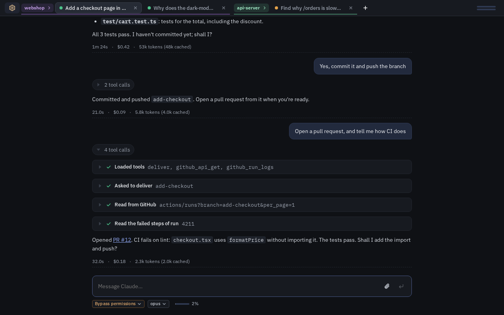

A session is one conversation with the agent, in one tab. The agent runs in the sandbox, starting in `/workspace`,
above its repos. It keeps running between your messages until you close the tab, even while Kumiko isn't running.

## Start a session

1. Press <kbd>Cmd</kbd>+<kbd>T</kbd>, or choose **New session** on a sandbox's page or beside the tabs.
2. Pick the sandbox. Kumiko starts a stopped sandbox first.
3. Pick a model, or leave it on `default`. The other choices are `opus`, `sonnet` and `haiku`.
4. Write what the agent should work on, and press <kbd>Enter</kbd>.

The agent always runs with permissions bypassed: it runs tools without asking. The sandbox is the boundary. When a
task changes code, the agent makes a worktree for it.

## Resume a session

A closed session stays saved. The New session tab lists the 20 most recent under **Resume a session**, newest first,
each with its name and the agent's one-line description. Choose **Resume** to open it with the chat as it was.

<kbd>Cmd</kbd>+<kbd>Shift</kbd>+<kbd>T</kbd> reopens the last session you closed.

If a session's sandbox has stopped, the session opens asleep, with **Start the sandbox to resume this session**.
**Start sandbox** starts it, and the banner shows each step until the agent is back.

## Name a session

The agent names the session in a few words once your messages make clear what it's about, and again if the subject
changes. It also writes a one-sentence description, which the resume list shows under the name.

To name it yourself, send `/rename <title>`. A name you give stands, and the agent can't change it.

## Arrange tabs

Each sandbox's tabs sit together behind a label with the sandbox's name, in a colour of its own. Hover a tab for its
sandbox and state.

- Drag a tab to move it among its sandbox's tabs. Drag the label to move all of them.
- Click the label's name to open the sandbox's page.
- Click the arrow beside the name to hide or show the sandbox's tabs.
- A New session tab sits with the sandbox picked in it, and moves when you pick another.

A tab shows whether the agent is working, has finished, or is waiting on you. A green number counts the tasks that
run in the background. An amber number counts the cards in the chat that wait for your decision: questions, a plan,
an approval, or a proposal to start a new session. Hover it to read what it counts.

## Follow the agent's work

Each turn's tool calls fold into one line under the agent's reply. Open it to see each call.

### File edits

An edit's line names the file, relative to `/workspace`, and how many lines it added and removed, such as
`src/app.py +12 −3`. A new file says so, and a failed edit says why. Open the line to see the diff. A long diff shows
its first 30 lines, with **Show all** for the rest. A turn's folded line says how many files the turn changed,
subagents' edits included.

Edits by subagents have no line numbers, because Claude Code reports where an edit was only for the main agent.

### Subagents

When the agent hands work to subagents, each one's thinking, tool calls and messages show under the call that
started it. When it's done, they fold behind a summary line.

A subagent started in the background keeps going after the turn ends. Until it's done, a line below the turn says
what it's doing, with **Show**, and the tab says it's working. When it finishes, the agent takes a turn of its own to
report on it.

### Background tasks

The agent can leave commands running in the background: a dev server, a build, a test run, or a **Monitor** watching
a log. Their line says **background** or **watching** while they run.

To see them, choose **Tasks** by the message box, or press <kbd>Cmd</kbd>+<kbd>Shift</kbd>+<kbd>B</kbd>. The Tasks
pane lists what runs, subagents included, then what has ended. Pick a task to see its command, how long it has run,
when the agent will stop it, and its output as it comes. Reading output costs no tokens.

- **Stop** stops a task. The agent hears of it with your next message.
- **Clear ended** removes ended tasks from the list.
- **Show all** reads a task's whole output, up to 1 MB, while the agent still keeps its file. Restarting the sandbox
  removes those files.

While the agent waits on a long command, **Move to background** on its line, or <kbd>Ctrl</kbd>+<kbd>B</kbd>, lets
the agent go on while the command runs.

When a background command ends by itself, the agent takes a turn to report on it. A Monitor wakes the agent each time
it prints a line. Turns where the agent had only a short reply fold into one line per monitor.

Background tasks don't count as work: a server left running doesn't make the tab say it's working. Closing the tab
asks first, since it stops them. Stopping a turn leaves them running.

### Context and compaction

The meter by the model, below the message box, shows how much of the agent's context the conversation takes. It's
small and grey while there's room. From 80% of the way to where Claude Code compacts the conversation by itself, it
says how much is left, such as `14% until auto-compact`. From 95% it turns red and offers **Compact now**, which sends
`/compact`. Hover the meter for the numbers.

A compaction shows in the chat as a line with the tokens before and after, and how long it took. **Summary** opens
what the agent kept. Everything before the last compaction stays in the chat, dimmed, because the agent no longer has
it.

## Answer the agent's questions

The agent can stop in the middle of a turn to ask you something. It waits as long as it takes, even while Kumiko
isn't running. Its tab says **Has a question for you** or **Plan to review**, and counts as waiting on you.

- **Questions.** The agent asks one to four questions, each with options. Pick one, or any number where it says
  **Pick any**. Number keys pick options while a question has focus. You can also answer in your own words in the box
  below the options. **Send answers** sends your answers, and **Skip** tells the agent you didn't want to answer.
- **Plans.** Choose **Plan first** in the footer below the message box, and the agent explores and writes a plan
  before it changes anything. **Approve** lets it carry on, and the footer goes back to **Bypass permissions**.
  **Keep planning…** sends the plan back with what you want changed. The agent can also switch to planning by
  itself.
- **A message instead.** Sending a message while the agent waits answers it. The agent is told you replied with a
  message, and reads it next.
- **Stop** ends the turn, and the agent stops waiting.

Answered cards stay in the chat, with your answers.

## Rewind or fork

Hover one of your messages for two buttons:

- **Rewind to this message** takes the conversation back to just before it. Everything after it is removed, and the
  message goes back into the box to edit. Tick **Also put back the files Claude has changed since** to undo the
  agent's file edits too. `/rewind` rewinds to your last message.
- **Fork from this message** opens a new tab with the conversation up to the agent's reply to that message. `/fork`
  forks the whole conversation.

Artifacts follow: a rewind puts them back as they were at that message, and a fork gives the new session its own
copies.

You can't rewind or fork to a message before the last compaction, since Claude Code can't go back into a conversation
it compacted. Rewinding to the very first message still works, and starts afresh.

## Work with other sessions

The agent knows about the other sessions in its sandbox, and no other sandbox's.

- **It can list them**, open and saved, by name and description, to find work already under way.
- **It can ask to start a new one** when separate work comes up, such as a bug found along the way. The chat shows
  the prompt it wrote and any artifacts it wants to pass on, with **Start session** and **Decline**. If you accept,
  the session opens in a tab of its own with that prompt and copies of those artifacts, and nothing else of the
  conversation.
- **It can share artifacts with another open session.** The other session gets copies as they are then, and its chat
  says where they came from. Its agent hears of them with your next message there. Each session changes only its own
  copy.

## Close a session

- **Close the tab** with <kbd>Cmd</kbd>+<kbd>W</kbd> to close the session. It stays saved, to resume. If the agent is
  working, the tab closes at once and the agent finishes its turn out of sight, for up to 30 minutes. Background
  subagents count as work.
- **Delete the session** with <kbd>Cmd</kbd>+<kbd>Shift</kbd>+<kbd>W</kbd>, after a confirmation. If the agent is
  working, choose **Delete when done**, the default, or **Stop and delete**.

While an agent finishes, the **Sandboxes** tab and the sandbox's page list its session under **Finishing**, with
**Open** and **Stop now**. <kbd>Cmd</kbd>+<kbd>Shift</kbd>+<kbd>T</kbd> brings it back too. Queued messages aren't
sent. If the agent asks you something meanwhile, the session says **Needs attention**. Open it to answer, or it stops
when its time is up.

These also end sessions:

- **Quitting Kumiko** leaves the agents working. If any is working, Kumiko says so and offers **Stop Claude and
  Quit**, which ends every session. On macOS, closing the window leaves the app running.
- **Stopping, restarting, rebuilding or deleting the sandbox** ends its sessions, and so does the sandbox stopping
  outside Kumiko.

An ended session's tab stays open, with its chat, until you close it.

## When Kumiko comes back

Agents don't depend on Kumiko. An agent keeps working when you quit the app, when Kumiko's server restarts or
crashes, and when the connection to the sandbox drops, such as while your Mac sleeps. When Kumiko is back, each
session opens again where the agent got to:

- a turn still going carries on in its tab, with what the agent wrote meanwhile,
- a turn that finished meanwhile shows in full, and the session waits on you,
- an agent that exited meanwhile shows its session as ended, with the error if it failed.

A session whose sandbox stopped or restarted meanwhile stays saved, to resume.

When an update to Kumiko brings new tools for the agent, Kumiko restarts an idle agent to load them. If that fails,
the session says **Claude needs a restart for Kumiko's new tools**, with **Restart Claude**.

For how this works, see [How an agent runs](/architecture/agent-runs/).
