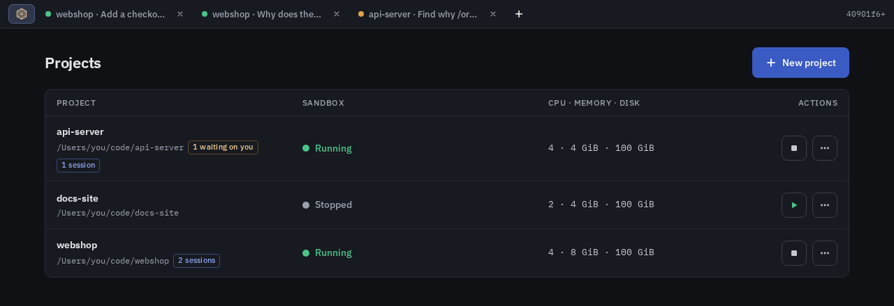

Kumiko is mission control for your coding agents. Start agents on any of your projects, let them work unattended, and
see at a glance what each one is doing and which ones need you.

## What you get

- **Agents that don't stop to ask.** Each project gets a sandbox the agent owns, so it works without permission
  prompts while your machine stays out of reach.
- **Many tasks at once.** Run several sessions on a project, each in its own tab and its own worktree, so they don't
  step on each other.
- **An overview of the work.** See which sessions are working and which are waiting on you, and where each worktree
  stands: uncommitted, unpushed or merged.
- **Agents that don't need Kumiko running.** Quit the app or restart it, and the agents keep working. When it's back,
  you see everything they did meanwhile.
- **Nothing to lose.** Your code and the agent's history live on your machine. A sandbox can be thrown away and
  rebuilt at any time.

## The pieces

- **A project** is one of your repositories. It's the first thing you create; everything else hangs off it.
- **A sandbox** is the project's isolated environment, where the agent works.
- **A session** is one conversation with the agent, in one tab.
- **A worktree** is a separate checkout the agent makes for a task, so parallel tasks stay apart.

See [Supported sandboxes and agents](/reference/supported/).

## Where to go next

| You want to… | Read |
| --- | --- |
| Try it | [Quick start](/getting-started/quick-start/) |
| Understand why it works this way | [Philosophy](/philosophy/) |
| Do something specific in the app | [User guide](/guide/projects/) |
