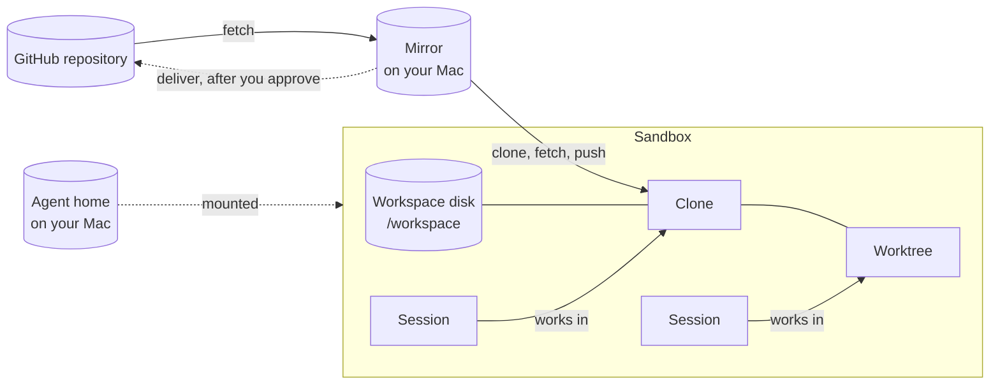

The rest of the docs use these words with these meanings.

## Repo

A repo is one of your GitHub repositories that you added to Kumiko. You add it once, and any sandbox can then have it.
See [Add repositories](/guide/repos/).

## Mirror

A mirror is a bare git repository on your Mac that Kumiko keeps for each repo, under `~/.kumiko/mirrors`. Kumiko
fetches it from GitHub. Sandboxes clone from it and push to it, and never talk to GitHub themselves. See
[How code reaches GitHub](/architecture/github/).

## Sandbox

A sandbox is where an agent works: a VM with a name you choose and the repos you pick. The agent owns the VM. It can
install, run and change anything there without asking. A sandbox has settings for its resources, the folders it mounts
from your Mac and the variables it forwards. See [Create and manage sandboxes](/guide/sandboxes/).

## Workspace disk

The workspace disk is a disk of the sandbox's own, mounted at `/workspace`, where the repos are cloned. It outlives
the VM: rebuilding the sandbox keeps it, and deleting the sandbox deletes it. Your Mac never opens it.

## Agent home

The agent home is the agent's configuration folder for one sandbox: its login, settings and history. It lives on your
Mac under `~/.kumiko/claude/<sandbox>` and is mounted into the sandbox. Your own agent configuration is never mounted.

## Kumiko folder

The Kumiko folder is a second folder each sandbox shares with your Mac, under `~/.kumiko/sandbox/<sandbox>`. It holds
what the agent keeps for Kumiko: artifacts and the agent's setup scripts.

## Session

A session is one conversation with the agent, shown in a tab. A sandbox can run many sessions at once. Each session's
agent process keeps running when Kumiko quits. See [Work in sessions](/guide/sessions/).

## Worktree

A worktree is a separate git checkout the agent makes for a task, in `/workspace/<folder>__worktrees/`. Kumiko tells
the agent to make one before it changes code, so two sessions don't edit the same checkout. Kumiko doesn't enforce
it.

## Artifact

An artifact is a file the agent shows in a pane beside the chat, such as a plan, a diagram, a chart or a page, and
keeps updating as it works. See [Use artifacts](/guide/artifacts/).

## Card

A card is a question in the chat that waits for your answer. The agent's questions and plans are cards. So are the
actions that need your approval, such as sending a branch to GitHub.
