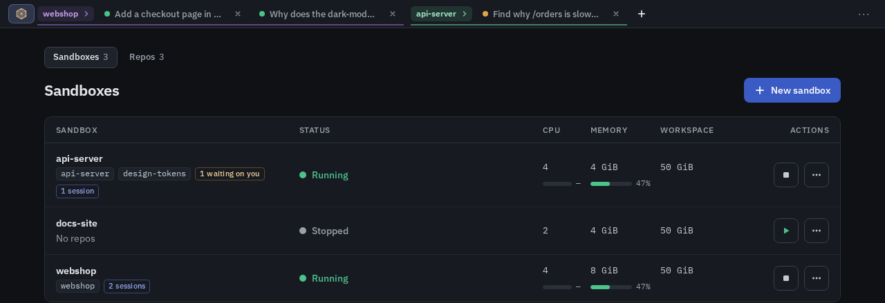

Kumiko is a Mac app for running coding agents on your GitHub repositories. Each agent works in a sandbox, a VM that
belongs to it, so it never stops to ask permission and can't reach the rest of your Mac. You start sessions across your
sandboxes, and one screen shows which agents are working and which are waiting for you.

Today the sandboxes are [Lima](https://lima-vm.io) VMs and the agent is [Claude Code](https://claude.com/claude-code).

## The problem

A coding agent asks before it runs a command, edits a file or installs a package. Answering each prompt keeps you at
the keyboard. Approving them without reading removes the protection they were for. Running several agents at once
multiplies both problems, and they share your machine, your credentials and your checkout.

## What Kumiko does about it

- The agent runs with permissions bypassed, inside a VM. What it can reach is what you gave the sandbox when you set
  it up: the repos, the folders you mount and the variables you forward.
- The sandbox has no GitHub credentials. The agent pushes to a mirror on your Mac, and its work reaches GitHub only
  when you approve it on a card.
- Several sessions run in one sandbox, each in its own git worktree, so parallel tasks don't touch the same checkout.
- The agent keeps working when you quit Kumiko or restart it. When Kumiko comes back, it shows what the agent did
  meanwhile.
- The repos sit on a disk that outlives the VM. You can rebuild a broken VM and carry on.

## Where to go next

| You want to | Read |
| --- | --- |
| Learn the words the docs use | [Concepts](/overview/concepts/) |
| Know why it works this way | [Principles](/overview/principles/) and [Decisions](/overview/decisions/) |
| See how it is built | [Architecture](/architecture/overview/) |
| See what it can do | [Features](/features/unattended/) |
| Try it | [Install and first session](/guide/quick-start/) |
| Work on Kumiko itself | [Development](/development/setup/) |
